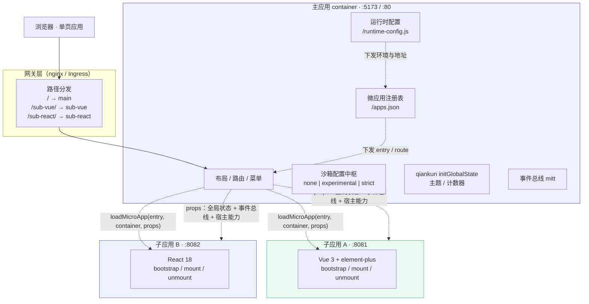
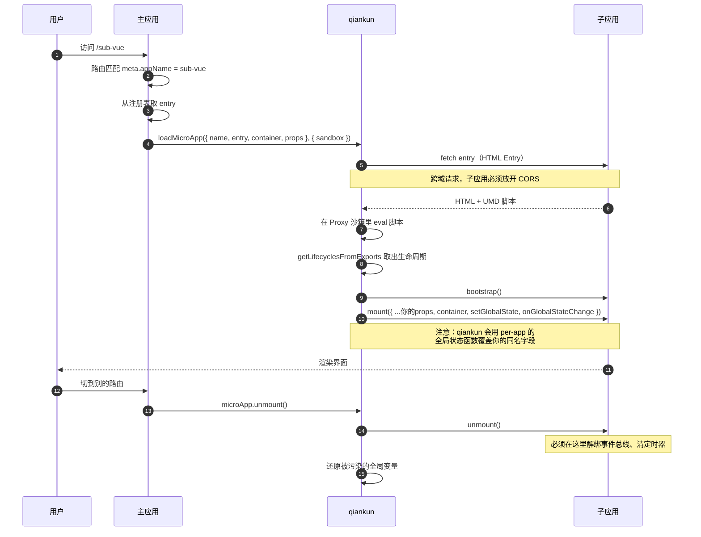
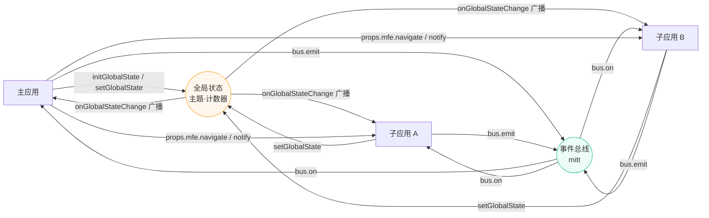

# 微前端实验室 · micro-frontend-lab

> 一个主应用 + 两个子应用（Vue3 / React18），把微前端最难的三个问题 —— **样式隔离**、**应用通信**、**独立部署** —— 做成可点击、可观察、可对比的实验台。

线上演示形态：主应用挂在 `/`，子应用 A 挂在 `/sub-vue/`，子应用 B 挂在 `/sub-react/`，三个应用**独立构建、独立部署**，通过 qiankun 在浏览器里拼成一个站点。

<p>
  
  
  
  
  
  
</p>

**状态：dev 与生产形态均已通过无头 Chrome 端到端验证**（5 条路由 + 跨应用通信断言），详见[第七节](#七自动化验证)。

---

## 目录

- [一、这个项目解决什么问题](#一这个项目解决什么问题)
- [二、架构](#二架构)
- [三、目录结构](#三目录结构)
- [四、快速开始](#四快速开始)
- [五、核心设计](#五核心设计)
  - [5.1 构建工具选型：为什么主应用 Vite、子应用 webpack](#51-构建工具选型为什么主应用-vite子应用-webpack)
  - [5.2 子应用如何被加载：qiankun 生命周期](#52-子应用如何被加载qiankun-生命周期)
  - [5.3 样式隔离](#53-样式隔离)
  - [5.4 应用通信](#54-应用通信)
  - [5.5 部署](#55-部署)
- [六、踩坑清单（20 条）](#六踩坑清单20-条)
- [七、自动化验证](#七自动化验证)
- [八、面试问答速查](#八面试问答速查)
- [九、可以继续做的](#九可以继续做的)

---

## 一、这个项目解决什么问题

单体前端膨胀到一定程度后，会遇到几个绕不过去的问题：

| 症状 | 微前端的解法 |
| --- | --- |
| 一个仓库十几个团队提交，发布互相阻塞 | 按业务域拆成独立仓库，各自发版 |
| 老系统技术栈是 Vue2，新业务想用 Vue3/React | 容器与框架解耦，子应用技术栈自由 |
| 改一行代码要全量回归 | 子应用独立部署，故障域收敛 |
| 依赖版本互相打架，升级一个炸一片 | 依赖不共享，各自锁定 |

但代价也很实在：**样式会互相污染、应用之间要通信、部署变成了一道拼装题**。

这个仓库就是把这三件事逐一做出来，并且**把每一处现象都做成可复现的实验**，而不是只给一份能跑的代码。

---

## 二、架构

### 2.1 部署架构



关键点：**主应用和子应用之间没有任何构建期依赖**。它们只在运行时通过一份 `props` 契约耦合。子应用的地址来自注册表，主应用新增一个子应用不需要改代码、不需要重新发布。

### 2.2 运行时加载时序



### 2.3 通信拓扑



---

## 三、目录结构

```
micro-frontend-lab/
├── package.json                    # npm workspaces 根，一条命令管三个应用
├── packages/
│   └── shared/                     # @mfe/shared：三端共享的通信协议常量
│       └── src/index.js            #   事件名 / 全局状态字段 / 隔离模式枚举
├── apps/
│   ├── main/                       # 主应用（容器）：Vue3 + Vite + qiankun
│   │   ├── public/
│   │   │   ├── runtime-config.js   #   运行时配置（容器启动时被覆盖）
│   │   │   └── apps.json           #   微应用注册表（可远端下发）
│   │   └── src/
│   │       ├── micro/
│   │       │   ├── registry.js     #   注册表拉取 + 降级
│   │       │   ├── sandbox.js      #   隔离模式 → qiankun sandbox 配置
│   │       │   ├── globalState.js  #   initGlobalState 封装
│   │       │   ├── eventBus.js     #   事件总线 + 广播记录
│   │       │   ├── props.js        #   ⭐ 下发给子应用的 props 契约
│   │       │   └── logger.js       #   统一运行时事件流
│   │       ├── components/
│   │       │   └── MicroAppHost.vue#   ⭐ 微应用容器组件（核心）
│   │       └── views/
│   │           ├── IsolationLab.vue      # 样式隔离实验室
│   │           ├── CommunicationLab.vue  # 通信实验室
│   │           └── DeployView.vue        # 部署方案
│   ├── sub-vue/                    # 子应用 A：Vue3 + webpack5 + element-plus
│   │   └── src/
│   │       ├── public-path.js      #   ⭐ 运行时 publicPath（必须第一个 import）
│   │       ├── mfe/context.js      #   宿主连接状态
│   │       └── main.js             #   ⭐ qiankun 生命周期
│   └── sub-react/                  # 子应用 B：React18 + webpack5
│       └── src/
│           ├── public-path.js
│           ├── mfe/store.js        #   自建 store + useMfeState Hook
│           └── main.jsx            #   ⭐ qiankun 生命周期
├── scripts/
│   ├── dev.mjs                     # 一条命令起三个 dev server
│   ├── serve.mjs                   # 本地模拟生产部署（等价 nginx）
│   ├── verify.mjs                  # ⭐ 无头 Chrome 端到端验证
│   └── lib/server.mjs              # 静态服务器 + 运行时配置生成
└── deploy/
    ├── nginx-standalone.conf       # 单机 nginx：三份 dist 拼一个域名
    ├── gateway.conf                # 容器拓扑：网关反代三个服务
    ├── nginx.conf                  # 单个应用容器内的配置
    ├── Dockerfile                  # 一个 Dockerfile 构建三个应用
    ├── docker-compose.yml          # 三个应用 + 网关
    └── entrypoint.sh               # ⭐ 运行时配置注入
```

---

## 四、快速开始

```bash
# 1. 安装依赖（npm workspaces，一条命令装三个应用）
npm install

# 2. 同时启动三个应用
npm run dev
#   主应用     http://localhost:5173
#   子应用 A   http://localhost:8081   ← 可以单独访问，独立开发调试
#   子应用 B   http://localhost:8082   ← 同上

# 3. 想看生产形态（三份 dist 拼成一个站点，路由规则与 nginx 完全一致）
npm run build
npm run serve        # http://localhost:4173

# 4. 端到端验证（真的开一个无头 Chrome 跑一遍，含跨应用通信断言）
npm run verify
```

也可以只起一个：

```bash
npm run dev:main      # 只起主应用
npm run dev:vue       # 只起子应用 A
npm run dev:react     # 只起子应用 B
```

### 已验证的页面

| 路由 | 说明 |
| --- | --- |
| `/` | 总览：架构图、当前运行态、子应用清单 |
| `/sub-vue` | 单挂子应用 A |
| `/sub-react` | 单挂子应用 B |
| `/lab/isolation` | **样式隔离实验室**：两个子应用同屏 + 三种隔离模式对比 |
| `/lab/communication` | **通信实验室**：全局状态 / 事件总线 / 宿主能力三通道 |
| `/deploy` | 部署方案：三种拓扑 + nginx / Docker 真实配置 |

右下角有一个常驻的**运行时事件流**面板，记录了 `unmount → mount → 状态变更 → 总线消息` 的完整时序 —— 排查微前端问题时，这个面板比到处 `console.log` 好用得多。

---

## 五、核心设计

### 5.1 构建工具选型：为什么主应用 Vite、子应用 webpack

这不是随意混搭，而是被 qiankun 的加载协议约束出来的结论。

qiankun 加载子应用的方式是 **HTML Entry**：把子应用的 `index.html` 拉下来，解析出里面的 `<script>`，在沙箱里 **eval 执行**，再从全局变量上取 `bootstrap / mount / unmount`。

```
fetch('/sub-vue/')  →  <script defer src="/sub-vue/js/main.abc123.js"></script>
                    →  eval 这段经典脚本
                    →  window['sub-vue'] = { bootstrap, mount, unmount }
```

而 Vite 的产物是 **ESM**：`<script type="module" src="/src/main.js">`。模块脚本不能通过 `eval` 执行（`import` 语句在 `eval` 里直接语法错误），所以 **Vite 子应用无法被 qiankun 直接加载**。

社区为此产出了大量第三方适配插件：

- `vite-plugin-qiankun`
- `@reus-able/vite-plugin-qiankun`
- `vite-plugin-qiankun-enhanced`
- `vite-plugin-qiankun-x`
- `@hansonfang/vite-plugin-qiankun-lite`

五个 fork，互不兼容，都停留在 Vite 2/3/4 时代。**当你看到一个问题有五个人各自造轮子，就该先考虑是不是路径本身有问题。**

所以本项目的选择是：

| 应用 | 工具 | 理由 |
| --- | --- | --- |
| 主应用 | **Vite 7** | 它是宿主，不参与 HTML Entry 协议。构建快、DX 好，占了便宜 |
| 子应用 A/B | **webpack 5** | 产物天然是经典脚本 + UMD，与 qiankun 沙箱 100% 兼容，dev/prod 行为一致，HMR 正常 |

如果团队确实要用 Vite 写子应用，两条可行路线（详见[踩坑 01](#六踩坑清单20-条)）：

1. 子应用 `vite build` 打成 UMD 产物供 qiankun 加载；开发时子应用自己用 Vite dev server 独立调试，集成时用构建产物；
2. 放弃 HTML Entry，自己实现 ESM 加载器 + 沙箱（等于重写一遍 qiankun，成本最高）。

### 5.2 子应用如何被加载：qiankun 生命周期

子应用必须导出三个函数，这是硬契约：

```js
// apps/sub-vue/src/main.js
export async function bootstrap() {
  // 只在首次加载时执行一次，适合初始化埋点 SDK。不要做耗时操作，会拖慢首屏。
}

export async function mount(props) {
  // props.container                       主应用给的容器 DOM
  // props.onGlobalStateChange/setGlobalState  qiankun 按 appInstanceId 生成的 per-app actions
  // props.mfe                             本项目的自定义宿主能力
  render(props);
}

export async function unmount() {
  // 必须在这里解绑事件总线、清定时器，否则内存泄漏
  disconnect();
  app?.unmount();
}
```

同时，子应用必须做到 **脱离主应用也能跑**：

```js
if (!window.__POWERED_BY_QIANKUN__) {
  render();  // 独立访问 :8081 时自己启动
}
```

这条 `if` 是微前端项目里最容易被忽略、但收益最高的三行代码 —— 它保证了子应用开发者不需要起整个主应用就能开发调试。

主应用侧用的是 `loadMicroApp`（手动模式）而不是 `registerMicroApps`（自动模式）：

```js
instance = loadMicroApp(
  { name, entry, container, props },
  { sandbox: buildSandboxConfig(isolationMode), singular: false },
);
await instance.mountPromise;
```

**手动模式的可控性更好**：可以做同屏对比、可以按需切换沙箱配置、可以在卸载后立刻重新挂载。自动模式是「路由驱动」的，适合菜单和子应用一一对应的简单场景。另外 `start()` 只应调用一次，反复调 `start()` 会重复注册全局路由监听。

### 5.3 样式隔离

qiankun 的沙箱其实有两个**正交**的能力，很多人会混淆：

| 能力 | 是否默认开启 | 由谁控制 |
| --- | --- | --- |
| **JS 沙箱**（Proxy 假 window、快照还原全局变量、劫持定时器） | ✅ 始终开启 | 不能通过配置关闭 |
| **样式隔离** | ❌ 默认关闭 | `strictStyleIsolation` / `experimentalStyleIsolation` |

所以界面上的「无隔离」**并不是没有沙箱**，只是没做样式隔离。这一点面试常问。

三种模式的实现与差别：

| 模式 | 原理 | 隔离强度 | 副作用 |
| --- | --- | --- | --- |
| 无隔离 | 子应用 `<style>` 直接进 `document.head` | 无 | 全站互相污染 |
| `experimentalStyleIsolation` | 给每条 CSS 规则加 `div[data-qiankun="应用名"]` 前缀 | 中（CSS 层） | 根选择器（`body`/`:root`）管不住；有 MutationObserver 开销 |
| `strictStyleIsolation` | 子应用被包进 Shadow DOM | 高（环境层） | `body` 样式失效；`position: fixed` 弹层包含块变化；CSS-in-JS 要额外处理 |

**实验怎么做**：两个子应用故意定义完全同名的类（`.mfe-lab-card` / `.mfe-lab-btn` / `.mfe-lab-title`），并且都给 `body` 设了背景色。配色刻意做成互补（A 绿色系、B 蓝紫系），一键切换模式就能肉眼看到谁覆盖了谁。

**核心代码**：

```js
// apps/main/src/micro/sandbox.js
export function buildSandboxConfig(mode) {
  switch (mode) {
    case 'strict':
      return { strictStyleIsolation: true };
    case 'experimental':
      return { experimentalStyleIsolation: true };
    default:
      return { strictStyleIsolation: false, experimentalStyleIsolation: false };
  }
}
```

切换模式时必须**重建容器**：

```vue
<MicroAppHost :key="`${appName}-${isolationMode}`" :app-name="appName" />
```

原因见[踩坑 06](#六踩坑清单20-条) —— ShadowRoot 挂载在容器元素上，复用旧容器会导致「切回无隔离后样式仍然是隔离的」。

### 5.4 应用通信

三条通道，适用场景完全不同：

| 通道 | 载体 | 有「当前值」 | 适合 | 不适合 |
| --- | --- | --- | --- | --- |
| **props 下发** | qiankun 挂载参数 | 有（快照） | 主 → 子下发能力、配置 | 子 → 主反向修改 |
| **全局状态** | `initGlobalState` | ✅ | 主题、用户、语言 | 高频变更、大对象 |
| **事件总线** | `mitt` | ❌ | 操作通知、局部刷新 | 需要"当前值"的场景 |

以下是读了 qiankun 源码之后才搞清楚的三个细节，和网上的常见说法并不一致：

**① `loadMicroApp` 会注入 per-app 的全局状态函数，并覆盖你传的同名字段**

`node_modules/qiankun/es/loader.js:445`：

```js
mount({
  ...你的props,
  container: appWrapperGetter(),
  setGlobalState: setGlobalState,            // ← 覆盖你的
  onGlobalStateChange: onGlobalStateChange,  // ← 覆盖你的
});
```

这两个函数来自 `getMicroAppStateActions(appInstanceId)`，是**每个子应用独立 id** 的版本。结论：

- 网上流传的「用 `loadMicroApp` 必须自己透传全局状态函数」并**不准确** —— 传了也会被覆盖，子应用照样能用；
- 好处是每个子应用有独立 listener id，不会互相覆盖。qiankun 内部是 `deps[id] = callback`，**同 id 会覆盖**，这也是为什么不能让三个应用共用一个 actions 对象；
- 本项目因此在 `props.js` 里**刻意不传**这三个函数，避免制造"我以为是我传的"这种误解。

**② `offGlobalStateChange` 不在覆盖之列，传下去会出大事**

qiankun 的实现是：

```js
offGlobalStateChange: function () { delete deps[id]; return true; }
```

如果主应用把自己的 actions 对象透传给子应用，子应用在 `unmount` 里调用它，删掉的是**主应用的 id** —— 主应用从此再也收不到任何状态变更。本项目从源头堵掉：不下发这个函数。

**③ 全局状态只接受「声明过」的第一层字段**

`setGlobalState` 内部会对 key 做校验，`initGlobalState` 时没声明过的 key 会被忽略并打警告：

```
[qiankun] 'xxx' not declared when init state！
```

而且它是**浅合并 + 全量广播**：一次 `setGlobalState` 会把整个快照 `cloneDeep` 后广播给所有订阅者。所以不要往里塞大对象，高频数据走事件总线。

### 5.5 部署

三种拓扑，本项目把前两种的配置都写全了：

| 拓扑 | 优点 | 缺点 | 适用 |
| --- | --- | --- | --- |
| **单域名按路径** | 一份证书、天然同源无 CORS | 子应用不能占根路径 | 同一团队维护 |
| **多域名独立部署** | 完全自治、故障隔离、可分别上 CDN | 必须处理 CORS、Cookie 跨域 | 多团队协作 |
| **主应用 + 对象存储/CDN** | 发布成本低、扩容无压力 | 需版本化缓存 | 已上云 |

**本项目的杀手锏：运行时配置注入。**

子应用地址不进 bundle，而是放在 `/runtime-config.js`，容器启动时由 `deploy/entrypoint.sh` 用环境变量生成：

```bash
docker compose -f deploy/docker-compose.yml up --build

# 改环境变量，只重启 main，镜像一个字节都没变：
MFE_ISOLATION=none docker compose -f deploy/docker-compose.yml up -d --no-build main
```

收益：

- 同一个镜像可以在 dev / staging / prod 之间流转，**回滚 = 换个镜像 tag，不需要重新构建**；
- 新增一个子应用 = 改注册表 JSON，**主应用不用发版**；
- 排查线上问题时能直接看到「当前生效的是哪份配置」。

> ⚠️ 配置写了不等于生效：这个链路里最容易犯的错是"配置项定义了但没有任何代码读它"。本项目真的踩过一次，见[踩坑 19](#六踩坑清单20-条)。

---

## 六、踩坑清单（20 条）

> 以下每一条都是本项目实际遇到并解决过的（其中 07、08 是读 qiankun 源码才定位的，16、17、19 是本项目构建/验证时真实踩到并修掉的）。
> 格式统一为：**现象 → 原因 → 解决**。

<details open>
<summary><b>坑 01 · qiankun 加载 Vite 子应用直接失败</b></summary>

**现象**：主应用报 `Application died in status LOADING_SOURCE_CODE: You need to export lifecycle functions`，或者子应用白屏 + 控制台 `Cannot use import statement outside a module`。

**原因**：Vite 的产物是 ESM（`<script type="module">`），qiankun 的 HTML Entry 机制要 `eval` 经典脚本，模块脚本在 `eval` 环境里 `import` 语句直接语法错误。

**解决**：子应用改用 webpack 5（本项目方案）；或者子应用 `vite build` 打成 UMD 产物供 qiankun 加载，开发期用子应用自己的 dev server 独立调试。

**一句话**：主应用用什么构建工具无所谓（它不参与加载协议），子应用必须产出「经典脚本 + UMD」。
</details>

<details>
<summary><b>坑 02 · 子应用没有导出生命周期</b></summary>

**现象**：`Application died in status NOT_MOUNTED: You need to export lifecycle functions`。

**原因**：webpack 必须配 `output.library + type: 'umd'`，否则打包结果是一个 IIFE，qiankun 从 window 上取不到任何东西。

**解决**：

```js
output: {
  library: { name: 'sub-vue', type: 'umd' },  // 与 appName 同名，正好命中 qiankun 的 fallback 查找
  globalObject: 'window',                      // 不加会打成 self/global，沙箱里取不到
}
```

顺带看一眼 qiankun 的取值顺序（`es/loader.js:165`），它会依次尝试：`scriptExports` → 沙箱最近设置的全局变量 → `window[appName]`。把 library 名字取成 `appName`，三条路都能命中。
</details>

<details>
<summary><b>坑 03 · 子应用资源全部 404，而且请求打到了主应用域名</b></summary>

**现象**：子应用加载进来后样式全丢、图片裂开，Network 里看到 `http://localhost:5173/js/main.js`（5173 是主应用端口，但 `/js/main.js` 是子应用的资源）。

**原因**：webpack 的 `output.publicPath` 默认是相对路径，主应用 `eval` 之后，相对路径按**主应用**的地址解析。

**解决**：dev 环境必须写完整绝对 URL。

```js
const publicPath = isDev ? `http://localhost:${PORT}/` : '/sub-vue/';
```

配合 `public-path.js` 在运行时修正动态 chunk 的地址（必须是子应用入口的第一个 import，因为 ESM import 会被提升，模块求值顺序就是声明顺序）：

```js
if (window.__POWERED_BY_QIANKUN__) {
  __webpack_public_path__ = window.__INJECTED_PUBLIC_PATH_BY_QIANKUN__;
}
```
</details>

<details>
<summary><b>坑 04 · 开发环境子应用加载失败，控制台报 CORS</b></summary>

**现象**：`Access to fetch at 'http://localhost:8081/' from origin 'http://localhost:5173' has been blocked by CORS policy`。

**原因**：qiankun 加载子应用的第一步就是 `fetch(entry)` 去拿子应用的 HTML。dev 阶段主应用在 5173、子应用在 8081，**天然跨域**。

**解决**：子应用 dev server 放开 CORS。

```js
devServer: {
  headers: { 'Access-Control-Allow-Origin': '*' },
}
```

生产环境如果用网关反代成同源就不需要；多域名部署时必须保留。
</details>

<details>
<summary><b>坑 05 · 两个 webpack 子应用同屏挂载，第二个报 Loading chunk failed</b></summary>

**现象**：单独挂载都正常，一旦在「隔离实验室」里同屏挂载，第二个子应用就报 `Loading chunk xxx failed`，或者两个子应用互相加载对方的 chunk。

**原因**：webpack 5 默认的 `chunkLoadingGlobal` 是 `webpackChunkwebpack`，两个子应用**同名**。它们运行在同一个 window 上，后加载的把先加载的 chunk 注册表覆盖了。

**解决**：给每个子应用唯一的 `chunkLoadingGlobal`（和 `uniqueName`）。

```js
output: {
  chunkLoadingGlobal: `webpackChunk_${APP_NAME}`,
  uniqueName: APP_NAME,
}
```

这是「子应用之间互相污染」最容易忽略的一种 —— 不是 CSS 污染，也不是 window 变量污染，而是**打包器运行时的全局注册表污染**。
</details>

<details>
<summary><b>坑 06 · 开启 strictStyleIsolation 后子应用白屏</b></summary>

**现象**：`experimental` 模式正常，切到 `strict` 后子应用白屏，控制台报找不到挂载点。

**原因**：`strictStyleIsolation` 会把子应用内容放进容器的 **ShadowRoot**，而 `Element.querySelector()` **不会穿透 Shadow 边界**，所以 `container.querySelector('#sub-vue-root')` 返回 `null`。

**解决**：挂载点解析加一层 ShadowRoot 兜底。

```js
function resolveMountNode(container) {
  if (!container) return document.querySelector('#sub-vue-root');
  return (
    container.querySelector('#sub-vue-root') ||
    container.shadowRoot?.querySelector('#sub-vue-root') ||
    null
  );
}
```

**还有两个连带问题**：

1. **ShadowRoot 挂在容器 DOM 元素上**。切换隔离模式时如果复用同一个容器，旧的 ShadowRoot 还在，会出现「切回无隔离后样式仍然是隔离的」。所以容器组件必须用 `:key` 强制重建：
   ```vue
   <MicroAppHost :key="`${appName}-${isolationMode}`" />
   ```
2. **验证脚本也不能用 `--dump-dom`**。`documentElement.outerHTML` 不序列化 Shadow 内容，会出现"隔离得越好越检测不到"的假阴性。本项目的 `verify.mjs` 因此走 CDP 主动穿透 Shadow 边界。
</details>

<details>
<summary><b>坑 07 · 你以为自己在"手动透传"全局状态，其实传了个寂寞</b></summary>

**现象**：按网上的教程在 `loadMicroApp` 的 props 里手动传了 `onGlobalStateChange` / `setGlobalState`，功能正常，但你自己包了一层做日志/拦截，发现完全没有生效。

**原因**：qiankun 2.10 的 `loader.js:445` 会这样组装 props：

```js
mount({ ...你的props, container, setGlobalState, onGlobalStateChange });
```

它拿 `getMicroAppStateActions(appInstanceId)` 生成的 per-app 版本**覆盖**了你的同名字段。

**解决**：不要试图在这里包装或替换这两个函数。要么接受 qiankun 的注入（本项目做法），要么改用 `registerMicroApps + start()` 并在 `beforeMount` 之类的钩子里做拦截。

**顺带纠正一个流行说法**：「`loadMicroApp` 不会注入全局状态，必须手动传」是错的，至少在 2.10 上不成立。
</details>

<details>
<summary><b>坑 08 · 子应用卸载一次后，主应用再也收不到状态更新</b></summary>

**现象**：子应用 A 卸载一次之后，主应用和其他子应用再也收不到全局状态变更。

**原因**：子应用在 `unmount` 里调用了 `offGlobalStateChange()`。qiankun 的实现是 `delete deps[id]`，`id` 来自 actions 对象本身 —— 主应用把同一份 actions 透传下去时，子应用这一刀把主应用的监听一起删了。

```js
offGlobalStateChange: function () { delete deps[id]; return true; }
```

**解决**：**不要把这个函数下发给子应用**，从源头堵掉。本项目在 `apps/main/src/micro/props.js` 里刻意只下发 `props.mfe` 自定义命名空间，不传 qiankun 的三个 actions。
</details>

<details>
<summary><b>坑 09 · 刷新子应用页面 404</b></summary>

**现象**：主应用用 history 路由，直接访问或刷新 `/sub-vue/xxx` 返回 nginx 404。

**原因**：这些路径在服务器上没有对应的物理文件，只有前端路由认识它们。

**解决**：nginx 加 SPA 回退；子应用路径用 `alias` 时**结尾斜杠必须与 location 一致**。

```nginx
location / {
    try_files $uri $uri/ /index.html;
}
location /sub-vue/ {
    alias /var/www/mfe/sub-vue/;        # 少一个斜杠就会变成 sub-vue/sub-vue/xxx
    try_files $uri $uri/ /sub-vue/index.html;
}
```
</details>

<details>
<summary><b>坑 10 · 子应用一挂载，主应用的地址就被改了</b></summary>

**现象**：子应用自己用了 `createWebHistory()`，挂载后主应用的路由被顶掉，或者浏览器地址栏出现莫名其妙的路径。

**原因**：子应用的 history base 默认是 `/`，它的 `push` 会直接操作同一个 `window.history`。

**解决**：三选一。

1. 子应用不引入 history 路由（本项目子应用用内部状态切页签）；
2. 子应用用 `createWebHistory(props.base)`，base 由主应用通过 props 下发；
3. 子应用用 `createMemoryHistory()`，路由状态完全放内存，与地址栏解耦。
</details>

<details>
<summary><b>坑 11 · 子应用反复挂载卸载后，控制台开始报错</b></summary>

**现象**：来回切几次路由后报 `Cannot read properties of null` 或数据错乱。

**原因**：子应用注册的事件总线监听、定时器、`window` 上的事件没有在 `unmount` 里清理。子应用卸载了，监听还在，下一次广播就写进了已销毁的实例。

**解决**：`unmount` 里成对清理；事件总线 API 提供返回值当作 `off` 函数用。

```js
const off = bus.on(EVENT, handler);
off();   // unmount 时调用
```

主应用侧同样要在 `unmount()` 完成之后再重建容器，避免上一次的异步回调打到新容器上。
</details>

<details>
<summary><b>坑 12 · React 18 子应用卸载时报同步卸载警告</b></summary>

**现象**：`Attempted to synchronously unmount a root while React was already rendering`，严重时子应用直接卡死。

**原因**：`createRoot` 之后，如果在 qiankun 的生命周期回调里同步调用 `root.unmount()`，可能正好落在 React 的渲染过程中。

**解决**：让出一个事件循环再卸载。

```js
export async function unmount() {
  disconnect();
  const current = root;
  root = null;
  await new Promise((resolve) => {
    window.setTimeout(() => {
      try { current.unmount(); } catch (e) { /* 重复卸载可忽略 */ }
      resolve();
    }, 0);
  });
}
```
</details>

<details>
<summary><b>坑 13 · 子应用给 body 设样式，隔离后失效 / 没隔离时污染</b></summary>

**现象**：子应用写了 `body { background: #eefbf4 }`，结果主应用背景被改了（无隔离时）；切到 strict 后这条样式又完全失效。

**原因**：Shadow DOM 里根本没有 `body` 元素，根选择器天然失效。而 `experimentalStyleIsolation` 的前缀重写也管不住 `body`/`:root` 这类根选择器。

**解决**：**子应用不要写全局根选择器**。主题色统一走主应用定义的 CSS 变量：

```css
/* 主应用定义 */
:root { --mfe-brand: #4f46e5; }
[data-theme='dark'] { --mfe-brand: #8b8cf9; }

/* 子应用消费 */
.mfe-lab-btn { background: var(--mfe-brand); }
```

CSS 自定义属性是**继承属性**，可以穿透 Shadow 边界，这是跨应用主题统一最干净的方式。本项目两个子应用的 `body` 背景色就是故意留着的反例。
</details>

<details>
<summary><b>坑 14 · UI 组件库和 CSS-in-JS 在 Shadow DOM 里的位置不对</b></summary>

**现象**：element-plus / antd 的样式在 strict 模式下部分失效，或者弹层（Modal / Dropdown）挂在 `document.body` 上跑到 Shadow 外面去了。

**原因**：这类库的样式和弹层容器默认都注入/挂载到 `document.head`、`document.body`。Shadow DOM 能隔离样式作用域，但拦不住"往哪个节点插"。

**解决**：把弹层的挂载点显式指向子应用自己的容器（element-plus 用 `append-to` / `teleported`，antd v5 用 `getPopupContainer` + `StyleProvider container={shadowRoot}`）。

本项目在子应用 B 里放了一个 **CSS-in-JS 探针**（运行时往 `document.head` 插 `<style>`），切到 strict 后可以直接在 DevTools 里看它到底落在 `document.head` 还是 ShadowRoot —— 先观察，再决定怎么适配。
</details>

<details>
<summary><b>坑 15 · 子应用发版了，用户刷新后还是老版本</b></summary>

**现象**：子应用重新部署，主应用拉到的还是旧资源，或者 `runtime-config.js` 的改动没生效。

**原因**：`index.html` 和 `runtime-config.js` 被浏览器或 CDN 缓存住了。它们是「指针」，缓存住就等于环境切换失效。

**解决**：`index.html`、`runtime-config.js`、`apps.json` 一律 `no-store`；带 contenthash 的静态资源反而应该长缓存。

```nginx
location ~* /index\.html$ {
    add_header Cache-Control "no-store, no-cache, must-revalidate";
}
location ~* \.(?:js|css|woff2?)$ {
    expires 1y;
    add_header Cache-Control "public, max-age=31536000, immutable";
}
```
</details>

<details>
<summary><b>坑 16 · 生产构建带着 eval sourcemap 和 localhost 地址（本项目真实踩到）</b></summary>

**现象**：`webpack --mode production` 打出来的包 11MB，`publicPath` 还是 `http://localhost:8081/` —— 上线必然白屏。

**原因**：配置里用 `process.env.NODE_ENV` 判断环境：

```js
const isDev = process.env.NODE_ENV !== 'production';   // ❌
```

但 **webpack CLI 的 `--mode production` 只设置 webpack 内部 mode，不会设置 Node 进程的 `process.env.NODE_ENV`**。于是命令行传了 `--mode production`，配置里的 `isDev` 仍然是 `true`：devtool 变成了 `eval-cheap-module-source-map`（体积暴涨 10 倍以上），publicPath 也写成了开发地址。

**解决**：配置导出成函数，从 `argv.mode` 读真实模式。

```js
module.exports = (env, argv = {}) => {
  const mode = argv.mode || process.env.NODE_ENV || 'development';
  const isDev = mode !== 'production';
  return { mode, devtool: isDev ? 'eval-cheap-module-source-map' : false, /* ... */ };
};
```

修完之后：sub-vue 从 **11.2MB → 496KB**。

**怎么发现的**：`npm run verify` 之前加了一步产物自查 —— grep 生产 HTML 里是否还有 `localhost`。这类"看起来构建成功、实际产物是错的"问题，光看 `compiled successfully` 是发现不了的。
</details>

<details>
<summary><b>坑 17 · 重复定义 process.env.NODE_ENV，把 React 开发版打进了产物</b></summary>

**现象**：构建输出 `WARNING in DefinePlugin: Conflicting values for 'process.env.NODE_ENV'`，React 子应用产物 3MB（正常应 160KB 左右）。

**原因**：子应用配置里又写了一遍：

```js
new webpack.DefinePlugin({
  'process.env.NODE_ENV': JSON.stringify(isDev ? 'development' : 'production'),
})
```

而 webpack 的 `mode` 已经内置了这个定义。两者冲突，导致 React 解析到了 `react.development.js`。

**解决**：删掉这个自定义定义，交给 webpack 的 `mode` 处理。产物 3.03MB → 164KB。
</details>

<details>
<summary><b>坑 18 · webpack-dev-server 里写了 strictPort，直接启动失败</b></summary>

**现象**：`npm run dev` 时子应用进程秒退：

```
Invalid options object. Dev Server has been initialized using an options object
that does not match the API schema.
 - options has an unknown property 'strictPort'.
```

**原因**：`strictPort` 是 **Vite** 的选项，webpack-dev-server v5 的 schema 里没有它。从 Vite 项目迁移过来时很容易顺手写上。

**解决**：删掉。webpack-dev-server 端口被占用时会自动 +1，为了不让它变成静默故障，加一个监听回调显式告警：

```js
devServer: {
  port: PORT,
  onListening: (devServer) => {
    const actual = devServer.server?.address()?.port;
    if (actual && actual !== PORT) {
      console.warn(`端口 ${PORT} 被占用，实际监听 ${actual}；请同步修改运行时配置里的 entry`);
    }
  },
}
```
</details>

<details>
<summary><b>坑 19 · 配置写了，但没有任何代码读它（本项目真实踩到）</b></summary>

**现象**：`MFE_ISOLATION=none npm run serve` 明明把运行时配置里的 `defaultIsolation` 改成了 `none`，但页面仍然是 strict 隔离（DevTools 里 ShadowRoot 依旧存在）。

**原因**：`runtime-config.js` 里定义了 `defaultIsolation`，但主应用的全局状态初始化时**硬编码**了 `'strict'`：

```js
export const globalState = reactive({ ...MFE_INITIAL_STATE });  // isolationMode: 'strict'
```

配置项存在 ≠ 配置项生效。这类问题不会报错、不会警告，只会"改了没反应"。

**解决**：让初始状态真的去读运行时配置。

```js
const runtimeConfig = getRuntimeConfig();
const initState = {
  ...MFE_INITIAL_STATE,
  isolationMode: runtimeConfig.defaultIsolation || MFE_INITIAL_STATE.isolationMode,
};
export const globalState = reactive({ ...initState });
export const globalStateActions = initGlobalState({ ...initState });
```

**怎么发现的**：`npm run verify` 输出里带上了 `env / 隔离` 和 `ShadowRoot` 计数。改 `MFE_ISOLATION=none` 后 ShadowRoot 理应变成 0，结果还是 2 —— 一眼就露馅了。

**教训**：给验证脚本加上"配置 → 可观测结果"的断言，是抓这类问题最省力的办法。
</details>

<details>
<summary><b>坑 20 · qiankun 3.0 会移除你现在依赖的两个能力</b></summary>

**现象**：控制台稳定出现两条警告：

```
[qiankun] globalState tools will be removed in 3.0, pls don't use it!
[qiankun] strictStyleIsolation configuration will be removed in 3.0,
          pls don't depend on it or use experimentalStyleIsolation instead!
```

**原因**：qiankun 官方在 2.x 就把这两块标记为待移除。

**解决 / 应对**：

- **全局状态**：把 `initGlobalState` 逐步替换成自己维护的发布订阅（本项目已经有一半能力在事件总线上），或者引入 Zustand / Pinia 这类独立状态库，由主应用持有实例、通过 props 下发。这样升级 3.x 时不受影响。
- **strictStyleIsolation**：官方建议改用 `experimentalStyleIsolation`；如果非要 Shadow DOM 级别的隔离，就自己在容器上 `attachShadow`（本项目 `MicroAppHost` 的挂载点解析逻辑已经兼容 ShadowRoot，迁移成本很低）。
- **长期看**：如果对隔离的要求很高，值得评估 **无界（wujie）** —— 它基于 Web Components + iframe 沙箱，隔离更彻底，且原生支持 Vite，不受 qiankun 这条演进路线影响。

**面试加分点**：能说出"我选 qiankun 是因为生态成熟，但我知道它的 3.0 计划，所以我刻意把状态管理和隔离实现都收敛到了一个模块里，迁移成本可控" —— 这比"qiankun 好用"高一个层次。
</details>

---

## 七、自动化验证

`npm run verify` 做的是很多微前端项目都没做的事：**真的拉起一个无头 Chrome，把跑起来的三端验一遍**。

```bash
npm run build && npm run verify          # 验证生产形态（三份 dist 拼站点）
npm run dev                              # 另开一个终端起 dev server
VERIFY_BASE_URL=http://localhost:5173 npm run verify   # 验证开发形态
```

### 它验证什么

| 检查项 | 说明 |
| --- | --- |
| 子应用是否真的渲染 | **穿透 Shadow 边界**取文本，确认子应用内容出现 |
| ShadowRoot 数量 | strict 模式下应为 2（两个子应用），none 模式下应为 0 |
| props 契约是否送达 | 读子应用根节点的 `data-mfe-connected` |
| **跨应用通信** | 点主应用「count +1」×3，断言 `main === sub-vue === sub-react === 3` |
| 控制台 | 收集 `error` / `warning` / 未捕获异常 |
| 错误遮罩 | 抓取容器上的加载失败提示文本 |

### 实测结果

**生产形态**（`MFE_ISOLATION=strict`）：

```
✔ /                    title 总览 · 微前端实验室                ShadowRoot 0
✔ /sub-vue             sub-vue 已渲染                          ShadowRoot 1
✔ /sub-react           sub-react 已渲染                        ShadowRoot 1
✔ /lab/isolation       sub-vue 已渲染  sub-react 已渲染         ShadowRoot 2
✔ /lab/communication   sub-vue 已渲染  sub-react 已渲染         ShadowRoot 2

✔ 通信断言：点主应用「count +1」×3
   before       main=0  sub-vue=0  sub-react=0
   after        main=3  sub-vue=3  sub-react=3
   三个应用读到的全局状态完全一致

[verify] 5 个路由全部通过，跨应用通信断言通过
```

**隔离模式可切换**（`MFE_ISOLATION=none`）：5 条路由的 ShadowRoot 全部为 **0** —— 证明运行时配置真的生效，且 `buildSandboxConfig` 起了作用。

**注册表降级**（`MFE_REGISTRY_URL=`）：远端注册表不可用时，主应用回退到内联配置，子应用照常渲染，5 条路由仍然通过。

**开发形态**（`VERIFY_BASE_URL=http://localhost:5173`）：同样 5/5 通过，通信断言通过。控制台只有两条 qiankun 官方弃用警告（见[踩坑 20](#六踩坑清单20-条)），无任何 error。

### 实现要点

- **不用 `--dump-dom`**：它不序列化 Shadow 内容，strict 隔离下必然误报。
- **走 CDP**：用 Node 22 内置的 `WebSocket` 直连 Chrome DevTools Protocol，**零额外依赖**（不需要 puppeteer / playwright）。
- **必须带 `--no-sandbox`**：在没有完整桌面会话的环境（CI / 容器 / 受限沙箱）里，Chrome 渲染进程起不来，表现是 *WebSocket 连得上但 `Runtime.enable` 永远不响应* —— 这个症状很有迷惑性，容易误判成代码问题。
- **遍历 Shadow 树查找元素**：`findDeep(selector)` 递归下钻 `shadowRoot`，这样无论隔离模式如何都能定位到子应用节点。

`npm run serve` 用 Node 模拟了生产 nginx 的完整路由（包括 `/runtime-config.js` 与 `/apps.json` 的运行时生成），所以本地就能验证「换环境变量不重新构建」这条链路 —— 不需要装 Docker。

---

## 八、面试问答速查

<details>
<summary><b>Q：为什么选 qiankun，不用 iframe / Module Federation / 无界？</b></summary>

- **iframe**：隔离最彻底（样式、JS、路由全部天然隔离），但刷新丢失状态、弹层不能跨 iframe、路由和通信都要靠 postMessage，用户体验和开发体验都差。适合嵌入完全不受控的第三方系统。
- **Module Federation**：解决的是「**构建时**共享模块」，本质是依赖复用，不是应用隔离。它能减小体积，但样式污染、JS 沙箱、路由协调还得自己搞。和 qiankun 是互补而非替代。
- **无界（wujie）**：Web Components + iframe 沙箱，隔离更彻底、原生支持 Vite，是目前很值得选的方案。代价是它对 `window` 的代理方式会让部分依赖原生 `window` 的库出问题。
- **qiankun**：生态最成熟、文档最多、样式隔离和 JS 沙箱开箱即用。选它是**工程确定性**优先。

**加分回答**：qiankun 2.x 已经明确 3.0 会移除 `globalState` 和 `strictStyleIsolation`（控制台就会打警告），所以本项目刻意把状态管理和沙箱配置都收敛在 `micro/` 目录下 —— 迁移成本可控。选型时把"退出成本"也算进去，才是成熟的判断。
</details>

<details>
<summary><b>Q：qiankun 的 JS 沙箱是怎么实现的？</b></summary>

qiankun 2.x 用 **Proxy 沙箱**：给每个子应用创建一个 `Proxy` 包裹的假 `window`，子应用里的 `window.xxx = 1` 实际写在 Proxy 的目标对象上，不污染真实 window。子应用卸载时丢弃这个对象，全局变量自然还原。

同时它会：
- 记录子应用新增/修改的属性做快照，卸载时还原；
- 劫持 `addEventListener` / `setInterval` / `setTimeout`，卸载时批量清理；
- 劫持动态样式表和脚本的插入（这也是样式隔离的落点）。

**注意**：JS 沙箱和样式隔离是两个独立开关，默认只开 JS 沙箱。
</details>

<details>
<summary><b>Q：主应用 Vite、子应用 webpack，为什么不全用 Vite？</b></summary>

因为 qiankun 是 HTML Entry + `eval` 经典脚本，而 Vite 产物是 ESM，`import` 语句在 `eval` 里直接语法错误。详见 [5.1](#51-构建工具选型为什么主应用-vite子应用-webpack)。

**加分回答**：反问"如果坚持全 Vite，你愿意自己实现一遍沙箱加载器吗？" —— 社区有 5 个互不兼容的第三方适配插件，这本身就是"路径有问题"的信号。
</details>

<details>
<summary><b>Q：微前端怎么做样式隔离？各自的代价是什么？</b></summary>

四个层次，从弱到强：

1. **命名规范 / BEM / CSS Modules**：成本最低，但靠人自觉，接入第三方库就失效；
2. **选择器前缀重写**（`experimentalStyleIsolation`）：自动加 `div[data-qiankun]` 前缀，管不住 `body`/`:root`，有 MutationObserver 开销；
3. **Shadow DOM**（`strictStyleIsolation`）：环境级隔离，最彻底。代价是根选择器失效、`position: fixed` 包含块变化、CSS-in-JS 和弹层库要额外适配；
4. **iframe**：完全隔离，代价是通信和体验。

**工程结论**：新项目用 Shadow DOM；存量项目（大量全局样式的 UI 库）用前缀重写；无论如何，**子应用不要写全局根选择器，主题走 CSS 变量**。
</details>

<details>
<summary><b>Q：子应用之间怎么通信？为什么不都用全局状态？</b></summary>

三条通道（见 [5.4](#54-应用通信)）：

- **props 下发**：主 → 子，单向、安全；
- **全局状态**：需要「当前值」的共享数据，新挂载的应用订阅一次就能拿到全量快照；
- **事件总线**：一次性通知，没有当前值的概念，错过就没了。

不放全局状态的原因：`initGlobalState` 是**浅合并 + 全量广播**，而且每次都会 `cloneDeep` 整个快照。塞进去的东西一变，所有订阅者都会被唤醒。高频、大对象放进去就是性能灾难。

**还能补一句**：qiankun 的全局状态既不能取消单个监听，又要求每个子应用只能有一个监听（同 id 会覆盖），所以复杂场景下更推荐自建状态库 + props 下发。
</details>

<details>
<summary><b>Q：三个应用怎么部署成一个站点？子应用发版要不要动主应用？</b></summary>

三种拓扑见 [5.5](#55-部署)。本项目做到的目标是：**子应用发版不影响主应用，也不需要主应用重新构建**。

关键手段：
1. 子应用地址放进 `/runtime-config.js` 和 `/apps.json`（运行时拉取），不进 bundle；
2. 主应用启动时拉注册表，失败自动降级到内联配置；
3. 带 contenthash 的资源长缓存，`index.html` / `runtime-config.js` 绝不缓存。

**回滚** = 换一个镜像 tag 或改一次注册表，而不是重新构建。
</details>

<details>
<summary><b>Q：微前端适合什么场景？什么时候不该用？</b></summary>

**适合**：多团队并行、技术栈需要渐进升级、遗留系统要逐步替换、子应用需要独立发布。

**不该用**：
- 团队就三五个人、一个仓库管得过来 —— 微前端带来的复杂度（构建、部署、通信、调试）会远超收益；
- 需要极致的首屏性能 —— 多个运行时、多份框架代码，体积一定比单体大（本项目两个子应用一共多背了 660KB）；
- 子应用之间交互非常密集 —— 通信成本会吃掉拆分收益。

**一句话**：微前端是**组织架构问题的技术解法**，先有组织问题，再谈技术方案。
</details>

---

## 九、可以继续做的

- [ ] 接入 `qiankun` 3.x / `无界`，对比新旧沙箱实现（见[踩坑 20](#六踩坑清单20-条)）
- [ ] 子应用路由方案（base 下发 / memory history）的完整实现
- [ ] 子应用预加载（`prefetch`）与按需加载的性能对比数据
- [ ] 主应用 CSS 变量主题体系贯通到两个子应用（当前是各写各的配色）
- [ ] 把自研 CDP 脚本换成 Playwright 用例并接入 CI
- [ ] 基于 `BroadcastChannel` 的跨标签页通信
- [ ] 子应用灰度发布（注册表里带 `version` / `gray` 字段）

---

## License

MIT
